# packed-spotter

Malware is usually packed or encrypted so that scanners cannot read it. Packing leaves a fingerprint: huge entropy, odd sections, and an empty section that unpacks itself into memory. packed-spotter reads a file, scores how likely it is packed, and shows you where.



**Live demo:** https://jvch0512.github.io/packed-spotter/ (an entropy map of a synthetic UPX-like sample, not real malware)

C++17, no dependencies, one binary.

## Use

```bash
make
./packed-spotter suspicious.exe
./packed-spotter suspicious.exe --html > report.html
./packed-spotter blob.bin --window 1024 --fail-on-packed      # exit 1 if score >= 60
```

It reports a score from 0 to 100 with the reasons, the per-section entropy for PE files, and an entropy map with one cell per window (default 512 bytes).

Signals: share of near-random windows (7.2+ bits per byte), section names used by known packers (UPX, ASPack, Themida, VMProtect, MPRESS and others), sections that are empty on disk but large in memory, writable and executable sections, high-entropy sections, and very few sections.

See [examples](examples) (three synthetic files built by `make_samples.py`) and [docs/sample-output.txt](docs/sample-output.txt).

## Limits

- PE files get the full analysis. Other formats (ELF, Mach-O) get the entropy analysis only.
- High entropy also appears in legitimate files: archives, media, installers, encrypted data. A high score is a reason to look closer, not a verdict. A packer that mimics normal entropy and section names will score low.
- The samples are synthetic PE headers with filler bytes. They exist to exercise the detector and contain no code.

## Where it fits

Malware triage queues, incident response, sandbox pre-filters ("unpack before analysing"), and detection engineering: a quick way to decide which samples need an unpacker first.

## Tests

```bash
make test    # 16 checks under AddressSanitizer and UBSan, including a 3000-case fuzz of corrupted PE files
```

MIT.
